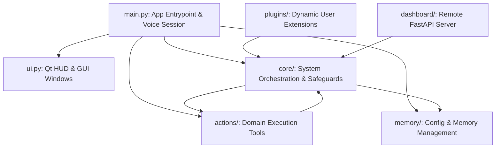

# Jarvis Desktop Agent Architecture

## 1. Overview
Jarvis-Desktop-Agent is a real-time, verified desktop AI assistant built on PyQt6, Google Gemini Live API, and Windows Automation APIs (Win32, UI Automation, CDP). It combines low-latency bi-directional audio streaming with multimodal desktop control and verified action execution.

## 2. Module Map



### Core Subsystems (`core/`)
- **`gemini.py`**: Authoritative model ladder, fallback strategies, and retry policies for Gemini APIs (`FAST`, `SMART` tiers).
- **`action_loader.py`**: Tool discovery and registration (`ActionRegistry`). Dynamically scans `actions/*.py` for self-describing `TOOL` dicts and wraps invocations in normalized `ActionResult` contracts.
- **`agent_orchestrator.py`**: Autonomous multi-step task execution loop (Observe -> Plan -> Execute -> Verify -> Recover).
- **`permissions.py`**: `ActionExecutionGuard` enforcing multi-tier safety (`READ_ONLY`, `NORMAL`, `SENSITIVE`, `DESTRUCTIVE`), user confirmations, credential scanning/redaction, and audit logging.
- **`outcome.py`**: Unified return contract (`ActionResult`) guaranteeing explicit status (`done`, `failed`, `needs_confirmation`, `unverified`, `started`, `unsupported`).
- **`audio_manager.py` & `audio_devices.py`**: Sounddevice audio I/O streaming, hybrid Bluetooth routing (A2DP stereo playback vs. HFP mic capture), device switching, and audio ducking.
- **`voice_state.py`**: Voice state machine (`LISTENING`, `THINKING`, `SPEAKING`, `SLEEPING`, `DISABLED`).
- **`echo.py` & `viseme.py`**: Acoustic self-echo suppression (`EchoGuard`) and formant/viseme lip-sync extraction (`VisemeStream`) driving the avatar mouth.
- **`wake_word.py`**: Local "Hey Jarvis" wake word detection via OpenWakeWord.
- **`plugin_loader.py`**: Dynamic discovery of community extensions from `plugins/*.py`.
- **`undo.py`**: Reversible action stack for filesystem and preference mutations.

### Domain Tools (`actions/`)
- Specialized tools providing real desktop automation: `computer_control`, `windows_control`, `windows_uia`, `browser_control`, `spotify_control`, `reminder`, `system_monitor`, `file_controller`, `file_processor`, etc.

### Memory & Config (`memory/`)
- **`config_manager.py`**: Thread-safe access to persistent preferences and API configurations (`config/api_keys.json`).
- **`memory_manager.py`**: Persistent memory store, session summaries, and semantic search.

---

## 3. Runtime Threads & Concurrency Model

The application enforces a strict separation of concerns across multiple concurrent threads:

1. **Qt Main Thread (GUI Thread)**
   - Owns the single `QApplication` instance created in `ui.py`.
   - Renders the HUD canvas (`HudCanvas`), holographic 3D avatar head (posed with `numpy`, rendered in software via `QPainter`), waveforms, and overlays.
   - Dispatches user clicks, animations, and system tray operations.
   - **Crucial Rule**: Tools in `actions/` and `plugins/` must NEVER create or modify Qt widgets directly. All UI interactions must route through thread-safe Qt signals on `JarvisUI` (`player.write_log`, `player.show_content`, etc.).

2. **Voice Session Thread (Asyncio Event Loop)**
   - Created in `main.py` (`VoiceSessionThread`).
   - Runs the asynchronous event loop driving the Gemini Live WebSocket session (`google-genai` live client).
   - Manages connection lifecycle, keepalive pings, reconnect backoffs, and real-time audio chunk transmission.

3. **Audio Capture Thread**
   - Managed by `sounddevice.InputStream` callback.
   - Captures 16 kHz 16-bit mono PCM microphone frames.
   - Computes RMS volume level for HUD visual feedback.
   - Dispatches frames to `EchoGuard` and `WakeWordDetector`, then feeds clean frames to the Voice Session asyncio queue.

4. **Audio Playback Thread**
   - Managed by `sounddevice.RawOutputStream`.
   - Pulls 24 kHz 16-bit mono PCM chunks received from Gemini Live and streams them to the system default or selected audio output.
   - Passes chunks concurrently to `VisemeStream` to pose the avatar mouth at ~50 Hz.

5. **Local Wake Word Inference Thread**
   - Background worker processing OpenWakeWord embeddings on incoming microphone audio while the assistant is in `SLEEPING` state.
   - Never streams voice audio to the cloud while asleep.

6. **Worker Threads for Tool Execution**
   - Tool calls dispatched from the Gemini Live session execute on background worker threads (`ThreadPoolExecutor` or dedicated threads).
   - Prevents blocking the live voice stream during disk I/O, network requests, or UI automation steps.

---

## 4. End-to-End Data Flow: Voice Input to Tool Execution to Spoken Result

```mermaid
sequenceDiagram
    autonumber
    actor User
    participant Mic as sounddevice Mic Input
    participant Echo as EchoGuard / WakeWord
    participant Loop as VoiceSession (Asyncio)
    participant Gemini as Gemini Live API
    participant Guard as ActionExecutionGuard
    participant Tool as Action / Plugin Worker
    participant UI as JarvisUI (Qt Thread)
    participant Out as sounddevice Audio Output

    User->>Mic: Speaks command ("Search for Python docs")
    Mic->>Echo: 16kHz PCM chunks
    Echo->>Echo: Filter acoustic self-echo / Verify awake
    Echo->>Loop: Stream audio frames
    Loop->>Gemini: Real-time Audio Frame chunks
    Gemini-->>Loop: Instant acknowledgment audio + tool_call
    Loop->>Out: Play acknowledgment ("Searching now...")
    Loop->>Guard: Validate tool call ("web_search", query="Python docs")
    alt Requires User Confirmation
        Guard->>UI: Emit confirmation prompt
        UI-->>User: Display confirmation dialog
        User->>UI: Confirm
        UI->>Guard: Approved
    end
    Guard->>Tool: Execute tool on worker thread
    Tool->>UI: Emit player.write_log() / show_content()
    Tool-->>Guard: Return ActionResult(status=done, data=...)
    Guard-->>Loop: Formatted tool response
    Loop->>Gemini: Send tool_response
    Gemini-->>Loop: Stream final spoken response audio
    Loop->>Out: 24kHz PCM response chunks
    Loop->>UI: Stream viseme mouth positions
    Out-->>User: Spoken voice output ("Here are the top results...")
```

---

## 5. Architectural Invariants
1. **Model Interaction Solely Through `core.gemini`**: Direct creation of ad-hoc model clients outside `core.gemini` is forbidden.
2. **Strict Thread Concurrency**: No widget creation or direct GUI modification outside the Qt Main Thread.
3. **Verified Tool Outlines**: Every tool execution must yield an explicit `ActionResult` indicating verification state.
4. **Boundary Isolation**: `core/` must never depend on or import from `actions/` or `gui/`.
